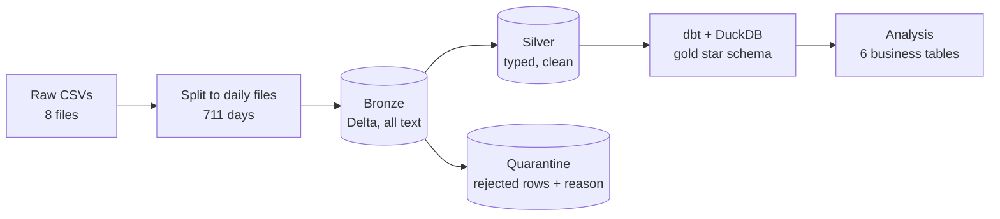

# Retail Lakehouse: a daily sales pipeline (bronze → silver → gold)

A batch data pipeline that loads daily retail sales files safely (reruns never create duplicates, bad rows are quarantined, not deleted) and builds analysis-ready tables to answer customer-behaviour questions.

**Stack:** PySpark + Delta Lake (bronze, silver), dbt + DuckDB (gold), pytest (tests).

## Architecture



| Layer | What it holds | Tool |
|---|---|---|
| Landing | One CSV per day (711 files) | DuckDB |
| Bronze | Raw data, all columns as text, partitioned by day | PySpark, Delta |
| Silver | Typed, cleaned rows. Rejected rows go to quarantine with a reason | PySpark, Delta |
| Gold | Star schema plus question tables, with tests | dbt, DuckDB |

## Data

[dunnhumby "The Complete Journey"](https://www.dunnhumby.com/source-files/): household-level transactions over two years from 2,500 households who are **frequent shoppers** at one retailer. It contains all of each household's purchases, not just a few categories. Some households also have demographics and direct-marketing contact history. The data is not in this repo (too large). Download it into `data/raw/`.

| Table | Rows |
|---|---|
| transaction_data | 2,595,732 |
| product | 92,353 |
| coupon | 124,548 |
| campaign_table | 7,208 |
| coupon_redempt | 2,318 |
| hh_demographic | 801 |
| campaign_desc | 30 |
| causal_data | 36,786,524 (not used, see decisions) |

**Assumption:** the data has only a day number (`DAY` 1 to 711), not real dates. I set **DAY 1 = 2024-01-01** to build a calendar. This is my choice, not part of the dataset. Results that use `day` or `week_no` do not depend on it. Anything "by month" does.

## Method

### 1. Landing
`scripts/split_to_landing.py` splits the transactions into one file per day, to simulate daily delivery. Check: 711 files, 2,595,732 rows.

### 2. Bronze (`src/ingestion`)
- Every column is loaded as text, so nothing is lost or guessed at this stage.
- Transactions are partitioned by day. Each day is written with Delta `replaceWhere`, so **rerunning a day replaces only that day and never duplicates**.
- The other 6 tables are single snapshots, so each run overwrites the whole table.
- Row counts are asserted against expected values.

### 3. Silver (`src/transform`)
**Transactions** (one day at a time):
- Cast columns to real types. A failed cast sends the row to quarantine.
- Build `transaction_ts` from the day and the `HHMM` time text.
- Zero quantity/sales rows are handled by the rules in the table below.
- Every day is checked: `bronze rows = silver rows + quarantine rows`.

**Reference tables** (one config-driven job for 6 tables):
- Cast number columns, fill blank product text with "Unknown", blank size with NULL.
- Coupon: exact duplicate rows are quarantined (keep one copy).

### 4. Gold (`dbt/models/gold`)
| Model | Purpose |
|---|---|
| `fact_sales` | One row per product line in a basket (2,581,266 rows) |
| `dim_product`, `dim_household`, `dim_date` | Descriptions for joins |
| `household_trend` | Is each household spending more, less or the same over time |
| `category_trend` | Spend and share of spend per department for the more/less groups |
| `demographic_spend` | Spend per household with demographics |
| `campaign_effect` | Baskets during a campaign vs an equal period before |

`dim_household` is built from the sales table (2,500 households) with demographics attached by left join, so the 1,699 households without demographics are never dropped. They are marked `has_demographics = false`.

### 5. Tests
- **pytest** (6 tests): bronze reruns never duplicate, other days stay untouched, each silver rule gives the right reason, coupon copies keep one row, blanks and bad numbers are handled.
- **dbt tests:** unique and not-null keys, every fact key finds its dimension row (no orphans), trend labels are only the allowed values.

## Data quality findings

**Zero quantity and zero sales** (the three cases in transactions):

| Case | Rows | Likely meaning | Rule |
|---|---|---|---|
| Quantity 0, sales 0 | 14,399 | Cancelled or void scan | Quarantine (`zero_qty_and_sales`) |
| Quantity 0, sales above 0 | 67 | Money with no units. **Unexplained** | Quarantine (`zero_qty_with_sales`) |
| Quantity above 0, sales 0 | 4,451 | Free or fully discounted item | Keep, flagged `is_zero_sale` |

**Other findings:**

| Finding | Count | What I did |
|---|---|---|
| Exact duplicate coupon rows | 5,164 | Quarantined (`duplicate_key`) |
| Products with blank department | 15 | Set to "Unknown" |
| Products with blank size | 30,607 | Set to NULL |
| Households with demographics | 801 of 2,500 | Others kept, flagged |

Final counts: transactions 2,595,732 = 2,581,266 silver + 14,466 quarantine. Coupon 124,548 = 119,384 + 5,164.

**Not investigated:** `2024-10-04` has 6 rows and `2025-10-04` has 2 (normal days have about 3,000 to 5,000). Some neighbouring days have identical row counts (for example 2024-03-18, 19 and 20). These may be gaps in the source data.

## Results

Spending change = total spend in days 1 to 355 vs days 356 to 711. A change of 15% or more counts as more or less.

**Q1: Who spends more or less over time?**

| Group | Households | Share |
|---|---|---|
| Spending more | 1,410 | 56% |
| Spending less | 670 | 27% |
| About the same | 396 | 16% |
| Stopped buying (lapsed) | 21 | 1% |
| New | 3 | 0.1% |

More households show rising spend than falling spend in this sample. This does not prove the store is growing.

**Q2 and Q3: Which categories grow or shrink for these groups?**
Households that spend more grow in nearly every department (+70% to +110%), and households that spend less shrink in nearly every department (-36% to -49%). **Categories mostly move together.** Share of the basket shifts only a little:
- "More" group: KIOSK-GAS rises from 6.3% to 7.6% of spend (+1.21 points). It is fuel, so this may reflect more store visits, not a food preference.
- "Less" group: GROCERY (-0.57 points) and MEAT (-0.53 points) lose the most share.

**Q4: Which demographics relate to spend?** (801 households with demographics only)

| Factor | Higher spend | Lower spend |
|---|---|---|
| Income | 150-174K: $8,395 | 15-24K: $4,097 |
| Household size | 5+: $6,699 | 1 person: $5,032 |
| Kids | 2 kids: $6,764 | None/Unknown: $5,299 |
| Age | 35-44: $6,403 | 65+: $4,241 |

Average two-year spend per household. These are links, not causes (income and household size overlap). Groups under 20 households are hidden.

**Q5: Do campaigns increase shopping trips?**
7,208 household-campaign pairs: 99,259 baskets in the period before, 96,568 during (ratio 0.97). **No evidence that campaigns increased trip count.** Trips are only one measure of engagement.

## Design decisions

| Decision | Why |
|---|---|
| Delta Lake over plain Parquet | Safe overwrites of one day, ACID writes, time travel |
| Quarantine, never delete | Rejected rows can be reviewed later |
| Silver runs one day at a time | Rerunning a day replaces only that day |
| DuckDB for gold | Gold is SQL on a dataset that fits one machine. dbt would work the same on a warehouse by changing only the connection |
| **SCD2 skipped** | The source has no history, so there is nothing to track. Faking it would be decoration |
| **`causal_data` excluded** | See below |
| Money kept as `double` | Simple, but `DECIMAL` is safer for real money |

**Why `causal_data` (36.8M rows) was dropped:**
- It lists only promoted product-weeks, so it has no baseline of its own.
- 15,245 product-store-weeks appear twice with different values, and I could not tell which was true.
- I tested it: promoted products did not show higher average weekly sales in dollars. This does not show that promotions fail. Stores choose which products to promote, and I measured dollars, not units.
- It was not needed for the other questions, so the cost was not worth it.

## Limits

- **2.6M rows is small for SparkIs.** I used Spark to practise the production tools. For this size DuckDB or Postgres would be enough, and I would choose them for a real project of this size.
- The households are frequent shoppers, so results may not apply to casual customers.
- Only 32% of households have demographics, and they may not represent all shoppers.
- Campaign windows can overlap when campaigns run back to back, so some "before" days belong to an earlier campaign.
- Spending trend compares two halves, so one large shop can move a household's label.
- The DAY to date mapping is an assumption.
- Not done yet: Docker and cloud storage.

## How to run

Requirements: Python 3.11, Java 17. On Windows, Spark also needs `HADOOP_HOME` with `winutils.exe`.

```bash
pip install -r requirements.txt

# put the 8 dunnhumby CSVs in data/raw/
python scripts/split_to_landing.py
python -m src.ingestion.load_bronze
python -m src.ingestion.load_bronze_reference
python -m src.transform.silver_transactions
python -m src.transform.silver_reference

cd dbt
dbt run
dbt test
cd ..

pytest tests -q
```

## Project layout

```
scripts/        one-off helpers (split to daily files)
src/ingestion/  raw -> bronze
src/transform/  bronze -> silver
dbt/models/     gold models and tests
tests/          pytest tests
notebooks/      exploration and gold analysis
```